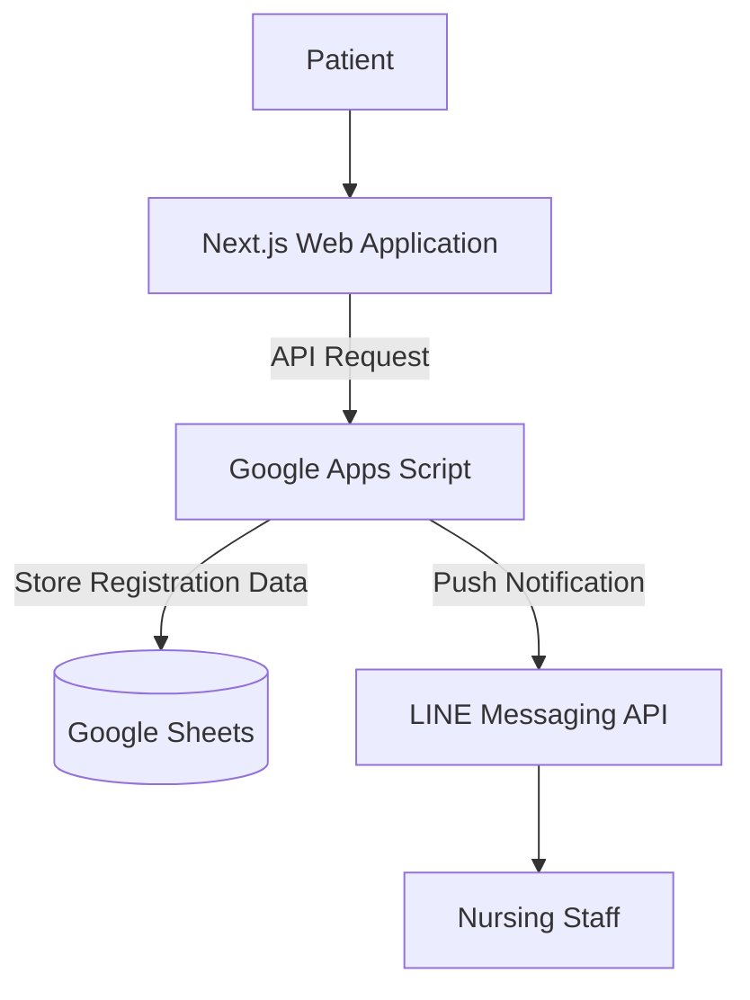

## Overview

[View Official Publication →](https://www.kppmu.go.th/news-detail?hd=1&id=124000)

## System Architecture

## Notification Preview

Automated Registration Notifications with **24/7** Real-Time Alerts for Senior Professional Nurses

## Tech Stack

- **Frontend:** Next.js, Tailwind CSS
- **Backend:** Google Apps Script
- **Data Storage:** Google Sheets
- **Messaging:** LINE Messaging API
